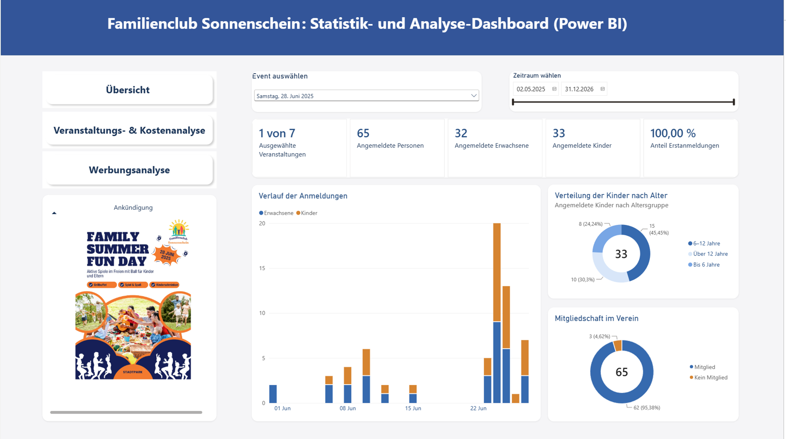
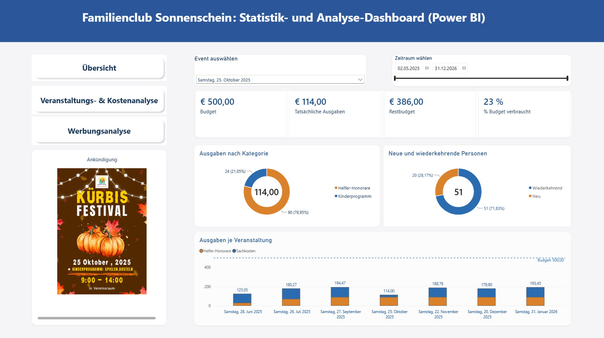
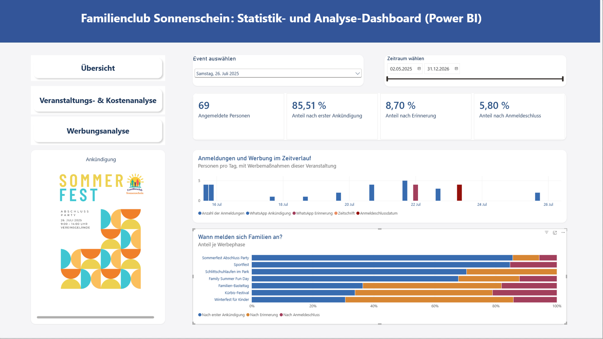

# Event-Analyse für einen Familienverein (Power BI)

Ein ehrenamtlich organisierter Familienclub veranstaltet monatliche Feste für Familien mit Kindern. Das Dashboard beantwortet drei Fragen für das Organisationsteam:

1. **Wie viele Familien melden sich an** – und wie setzen sie sich zusammen (Erwachsene, Kinder, Altersgruppen, neue Familien)?
2. **Wann melden sie sich an** – nach der ersten Ankündigung, nach der WhatsApp-Erinnerung oder erst nach Anmeldeschluss?
3. **Reicht das Budget** – wie viel wurde je Veranstaltung und Kategorie ausgegeben?

👉 **Kurzüberblick mit den wichtigsten Kennzahlen:** [Projektseite im Portfolio](https://levynska-i-ds.github.io/projekt-event-dashboard.html)

---

## Ergebnisse (7 Veranstaltungen, Juni 2025 – Januar 2026)

| Kennzahl | Wert |
|---|---|
| Angemeldete Personen | 415 (Ø 59 je Fest) |
| Anteil Kinder | 53 % |
| Personen je Anmeldung | Ø 3,5 |
| Budget genutzt | 34 % (1.176 € von 3.500 €) |

**Erkenntnisse**

- **Die Erinnerung wirkt:** Bei drei der letzten vier Feste kam fast die Hälfte der Anmeldungen (45–55 %) erst nach der WhatsApp-Erinnerung.
- **Spätanmeldungen einplanen:** 13 % melden sich nach Anmeldeschluss an, beim Kürbis-Festival 21 %.
- **Stammpublikum:** Nach dem ersten Fest stammen nur 23 % der Anmeldungen von neuen Familien.
- **Budget mit Spielraum:** rund 2,83 € pro angemeldeter Person; größter Posten sind Helfer-Honorare (47 %).

---

## Dashboard

| Seite | Inhalt |
|---|---|
| **Übersicht** | Kennzahlen, Anmeldeverlauf, Altersgruppen der Kinder, kostenloser/kostenpflichtiger Eintritt |
| **Veranstaltungs- & Kostenanalyse** | Neue Personen, Budget vs. Ausgaben, Ausgaben nach Kategorie (inkl. Helfer-Honorare) |
| **Werbungsanalyse** | Anmeldungen je Werbephase, Zeitstrahl mit Ankündigung, Erinnerung und Anmeldeschluss |





🎬 [Demo-Video](video.mp4)

---

## Umsetzung

**Datenquelle:** SQL-Server-Datenbank (`SonnenscheinDemo`), Import in Power BI.

**Datenmodell (Stern-Schema)**

- Fakten: `F_Anmeldungen`, `F_Anmeldungen_Kinder`, `F_Werbung`, `F_Expenses`, `F_Helpers`, `F_BudgetLimits`
- Dimensionen: `D_Veranstaltung`, `D_Datum`, `D_Erwachsene`, `D_Kinder`, `D_Werbekanal`, `D_BudgetKategorie`
- Berechnete Tabelle `Ausgaben_alle` (Belege + Helfer-Honorare), damit Kategorie-Diagramm und Gesamtausgaben übereinstimmen

**Ausgewählte DAX-Logik**

```DAX
-- Jede Anmeldung genau einer Werbephase zuordnen (berechnete Spalte)
Phase_Anmeldung =
VAR ev = F_Anmeldungen[VeranstaltungID]
VAR d  = F_Anmeldungen[Datum]
VAR Erinnerung =
    CALCULATE ( MIN ( F_Werbung[WerbungsDatum] ),
        FILTER ( ALL ( F_Werbung ),
            F_Werbung[VeranstaltungsID] = ev && F_Werbung[WerbekanalID] = 3 ) )
RETURN
SWITCH ( TRUE (),
    d > F_Anmeldungen[AnmeldeschlussDatum], "Nach Anmeldeschluss",
    NOT ISBLANK ( Erinnerung ) && d > Erinnerung, "Nach Erinnerung",
    "Nach erster Ankündigung" )

-- Anteil je Phase: summiert sich bei jedem Filter auf 100 %
Anteil_Erinnerung =
DIVIDE ( CALCULATE ( [Personen_gesamt], F_Anmeldungen[Phase_Anmeldung] = "Nach Erinnerung" ),
         [Personen_gesamt] )

-- Personen, die zum ersten Mal angemeldet sind
Neue_Personen =
CALCULATE (
    SUM ( F_Anmeldungen[AnzahlErwachsene] ) + SUM ( F_Anmeldungen[AnzahlKinder] ),
    FILTER ( F_Anmeldungen,
        F_Anmeldungen[Veranstaltungsdatum] =
            CALCULATE ( MIN ( F_Anmeldungen[Veranstaltungsdatum] ),
                        ALLEXCEPT ( F_Anmeldungen, F_Anmeldungen[ErwachseneID] ) ) ) )
```

---

## Daten & Annahmen

- **Anonymisiert:** Alle Namen, E-Mail-Adressen und Telefonnummern sind erfunden, Geburtsdaten um bis zu ±90 Tage verschoben, Freitext entfernt. Die Anonymisierung erfolgte per SQL-Skript in einer separaten Datenbank.
- **Anmeldung ≠ Teilnahme:** Die Zahlen zeigen die Teilnahmeabsicht, nicht die tatsächliche Anwesenheit.
- **Kosten:** Helfer-Honorare werden den Veranstaltungskosten zugerechnet; in der Praxis könnten sie aus einem separaten Personalbudget stammen.
- Rundungsdifferenzen bei Prozentwerten sind möglich.

## Technologien

Power BI Desktop · DAX · Power Query · SQL Server (T-SQL) · Datenmodellierung (Stern-Schema)
