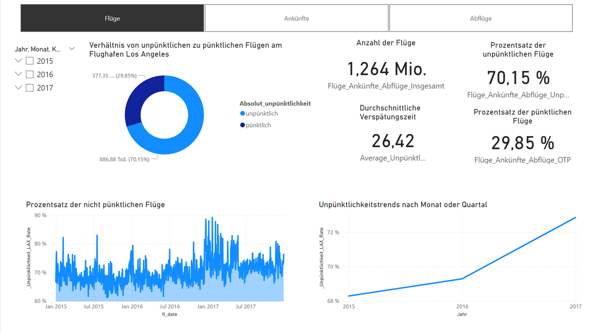
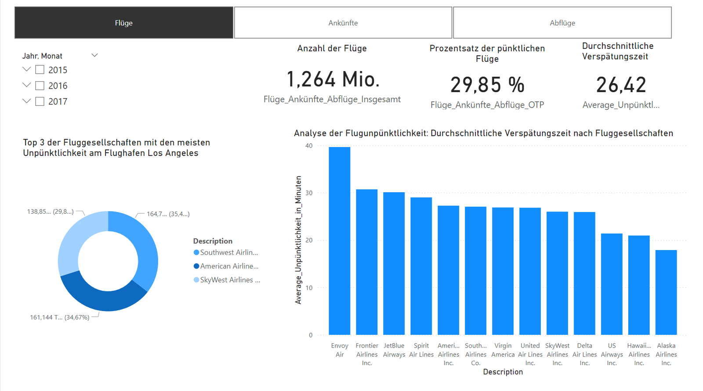
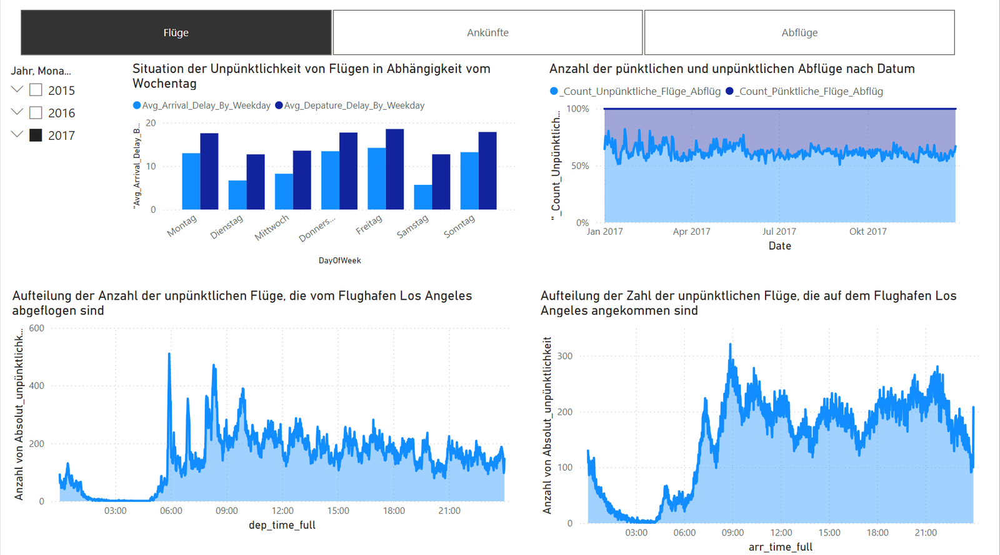
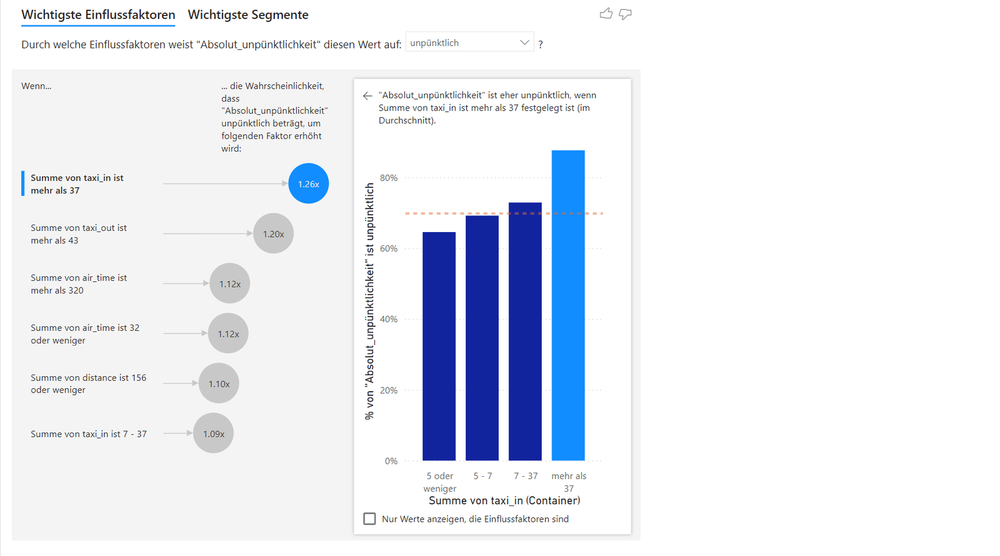

# Analyse unpünktlicher Flüge am Flughafen Los Angeles (Power BI + SQL)

**Abschlussprojekt** der Weiterbildung *Business Intelligence Specialist (Zertifikat)* bei StackFuel, Juni 2024.

**Szenario:** Der Flughafenbetreiber „fLAirport“ möchte unpünktliche Flüge am Los Angeles International Airport (LAX) regelmäßig untersuchen. Ein gemeinsamer Bericht soll allen Abteilungen dieselbe Diskussionsgrundlage geben und zeigen, wo interne Prozesse angepasst werden sollten.

Der Bericht beantwortet drei Fragen – jeweils getrennt nach **Abflug** und **Ankunft**:

1. Wie sehen die wichtigsten Kennzahlen zu Flügen und Pünktlichkeit aus?
2. Welche drei Airlines haben die höchste durchschnittliche Unpünktlichkeit pro Flug – und wie hoch ist ihr Anteil unpünktlicher Flüge?
3. In welchen Zeiträumen (Jahr, Quartal, Monat, Kalenderwoche, Wochentag, Tageszeit) treten Unpünktlichkeiten gehäuft auf?

👉 **Kurzüberblick:** [Projektseite im Portfolio](https://levynska-i-ds.github.io/projekt-flugverspaetungen.html)

---

## Daten

- US-Flugdaten des **Bureau of Transportation Statistics (U.S. Department of Transportation)**, bereitgestellt in einer PostgreSQL-Kursdatenbank, plus `UNIQUE_CARRIERS.csv` mit den Namen der Airlines.
- Zeitraum 2015–2017, alle Flüge von und nach LAX, **ohne** gestrichene oder umgeleitete Flüge: **1.264.229 Flüge** (632.275 Ankünfte, 631.954 Abflüge).
- **Definition laut Aufgabenstellung:** Ein Flug gilt als unpünktlich, wenn er **mindestens 5 Minuten** von der geplanten Zeit abweicht – **zu spät oder zu früh**. Die durchschnittliche Unpünktlichkeit bezieht sich nur auf die unpünktlichen Flüge.

> Hinweis: Der Zugang zur Kursdatenbank besteht nicht mehr. Die .pbix enthält die importierten Daten, der Bericht ist daher vollständig nutzbar, kann aber nicht aktualisiert werden.

---

## Ergebnisse

| Kennzahl | Gesamt | Ankunft | Abflug |
|---|---|---|---|
| Flüge | 1.264.229 | 632.275 | 631.954 |
| Anteil unpünktlich (±5 Min) | 70,2 % | 82,0 % | 58,3 % |
| – zu spät (≥ 5 Min) | 34,9 % | 35,7 % | 34,2 % |
| – zu früh (≥ 5 Min) | 35,2 % | 46,3 % | 24,1 % |
| Ø Unpünktlichkeit (nur unpünktliche Flüge) | 26,4 Min | 26,5 Min | 26,3 Min |

**Erkenntnisse**

- **Zu früh ist das häufigste Problem bei Ankünften:** 46 % der Flüge landen mindestens 5 Minuten vor Plan. Für den Flughafen bedeutet das: Gates und Bodenpersonal müssen früher bereitstehen.
- **Top 3 nach Ø Unpünktlichkeit pro Flug:** Envoy Air (39,6 Min; nur 309 Flüge), Frontier Airlines (30,7 Min; 77,6 % unpünktlich) und JetBlue Airways (30,1 Min; 74,3 % unpünktlich).
- **Leichter Anstieg über die Jahre:** von 68,3 % (2015) auf 72,9 % (2017).
- **Tageszeit:** Morgens (6–12 Uhr) ist der Anteil am niedrigsten (65 %), abends (18–24 Uhr) am höchsten (75 %). Verspätungen bauen sich über den Tag auf.
- **Dezember** ist der Monat mit dem höchsten Anteil unpünktlicher Flüge (72,6 %), September der niedrigste (68,7 %).
- **Einflussfaktoren (Key Influencers):** Lange Rollzeiten erhöhen die Wahrscheinlichkeit, unpünktlich zu sein – Taxi-In über 37 Minuten um den Faktor 1,26, Taxi-Out über 43 Minuten um 1,20.

---

## Dashboard

| Seite | Inhalt |
|---|---|
| **Flüge und Unpünktlichkeit** | Kennzahlen, Anteil pünktlich/unpünktlich, täglicher Verlauf, Trend nach Jahr/Quartal/Monat |
| **Unpünktlichkeit nach Fluggesellschaften** | Top 3 Airlines, Ø Unpünktlichkeit je Airline |
| **Zeiträume der Unpünktlichkeit** | Wochentag, täglicher Anteil, Verteilung über die Uhrzeit für Abflüge und Ankünfte |
| **Ankunft und Abflug** | unpünktliche Flüge je Airline, Zusammenhang zwischen verspätetem Abflug und Ankunft |
| **Fortgeschrittene Methoden** | Key-Influencers-Visual: Einfluss von Rollzeiten, Flugzeit und Distanz |

Auf allen Seiten wechselt eine Schaltfläche zwischen **Flüge / Ankünfte / Abflüge** (Auswahltabelle + `SWITCH`-Measures).






📁 Power-BI-Datei: [Analyse_unpuenktlicher_Fluege.pbix](Analyse_unpuenktlicher_Fluege.pbix)

---

## Umsetzung

**1. SQL (PostgreSQL) – Daten direkt beim Laden filtern**

```sql
SELECT flight_id, fl_date, op_carrier, op_carrier_fl_num, origin, dest,
       crs_dep_time, dep_time, dep_delay, taxi_out, wheels_off, wheels_on, taxi_in,
       crs_arr_time, arr_time, arr_delay, crs_elapsed_time, actual_elapsed_time,
       air_time, distance,
       ABS(dep_delay) AS absolute_dep_delay,
       ABS(arr_delay) AS absolute_arr_delay,
       CASE WHEN origin = 'LAX' THEN 'Departure'
            WHEN dest   = 'LAX' THEN 'Arrival'
       END AS IsArrivalOrDeparture
FROM flights
WHERE fl_date BETWEEN '2015-01-01' AND '2017-12-31'
  AND (origin = 'LAX' OR dest = 'LAX')
  AND cancelled = FALSE
  AND diverted  = FALSE
```

**2. Power Query** – Uhrzeiten im Format `hhmm` (ohne führende Nullen, mit `2400`) in echte Zeitwerte umgewandelt: `2400` → `2359`, mit `Text.PadStart` auf vier Stellen aufgefüllt, Datentyp *Zeit*. Kopfzeile der Airline-Tabelle korrigiert.

**3. Datenmodell und DAX**

- Beziehung `Flüge[op_carrier]` → `Fluglinien[Code]` (Klarnamen der Airlines)
- Kalendertabelle in DAX (`CALENDAR` + Jahr, Quartal, Monat, Kalenderwoche, Wochentag)
- Berechnete Spalte „pünktlich / unpünktlich“, getrennt für Abflug und Ankunft
- Measures für Anzahl, Anteile und Ø Unpünktlichkeit; eine Auswahltabelle mit `SWITCH` steuert die Ansicht Flüge / Ankünfte / Abflüge

```DAX
SUM_Unpünktlichkeit_Minuten_Ankunft =
CALCULATE ( SUM ( 'Flüge'[absolute_arr_delay] ),
    'Flüge'[arrivalordeparture] = "Arrival"
        && 'Flüge'[Absolut_unpünktlichkeit] = "unpünktlich" )

AverageUnpünktlichkeit_in_Minuten_proFlug_Ankunft =
[SUM_Unpünktlichkeit_Minuten_Ankunft] / [_Count_Unpünktliche_Flüge_Ankunft]
```

**4. Data Storytelling** – 15-minütige Präsentation der Ergebnisse vor den Abteilungsleitungen.

---

## Was ich heute anders machen würde

- Neben der vorgegebenen ±5-Minuten-Regel zusätzlich den Branchenstandard zeigen (verspätet ≥ 15 Minuten: Ankunft 23,2 %, Abflug 22,3 %).
- „Zu früh“ und „zu spät“ getrennt ausweisen, weil sie unterschiedliche Maßnahmen erfordern.
- Für das Airline-Ranking eine Mindestanzahl an Flügen festlegen (Envoy Air hat nur 309 Flüge).
- Weniger Visuals pro Seite und einheitliche, sprechende Achsentitel.

**Werkzeuge:** PostgreSQL, Power BI Desktop, Power Query (M), DAX, PowerPoint
